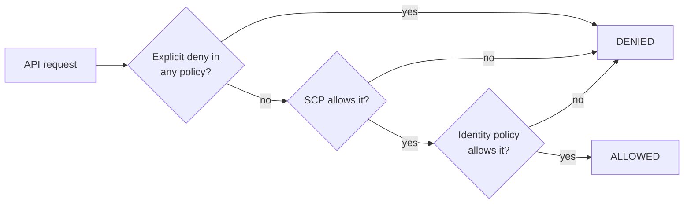

# AWS Access Check: "I'm an admin, so why am I denied?"


A read-only Bash tool that tells you **which AWS services you can reach**, and when you're blocked, **what blocked you**: an IAM policy, an AWS Organizations service control policy (SCP), a permissions boundary, a region lock, or an expired login.

I built it while debugging my own account, where a role with `AdministratorAccess` was denied on almost every service. This README is the write-up of that investigation.

---

## The problem

My AWS project account gave my CLI role the `AdministratorAccess` policy. Even so, most services returned access-denied errors:

| Service | Result in `us-east-1` |
|---|---|
| IAM, S3, Route 53, CloudWatch, CloudWatch Logs, Bedrock, Budgets | ✅ allowed |
| EC2, VPC, Lambda, ECR, ECS, EKS, CloudFormation, DynamoDB, SSM, Secrets Manager | ❌ denied |

An admin role being denied means something **outside** the role is overriding it.

## Investigation

**1. CloudShell couldn't get credentials.**
Every command failed with `Error retrieving metadata: Received non 200 response 500 from container metadata`. That's CloudShell's internal credential service failing, not a permissions issue. Rather than debug a managed service I don't control, I moved to the AWS CLI v2 in WSL (Ubuntu) and authenticated with `aws login`. WSL can't open the Windows browser (`gio: Operation not supported`), so I used `aws login --remote`, which gives you a URL to open and a one-time code to paste back.

**2. I probed systematically instead of guessing.**
I wrote the first version of this script to call one read-only API per service and record allowed vs. denied. A pattern appeared: mostly **global** services (IAM, S3 bucket listing, Route 53, Budgets) worked, and almost every **regional** service failed.

**3. I read the full error message.**
```text
UnauthorizedOperation ... is not authorized to perform: ec2:DescribeVpcs
with an explicit deny in a service control policy:
arn:aws:organizations::<ORG_MGMT_ACCOUNT>:policy/<ORG_ID>/service_control_policy/<POLICY_ID>
```
This was the turning point. The deny came from an **SCP**, and the policy belonged to a *different* AWS account: the AWS-managed organization that my project account is a member of. SCPs don't grant permissions. They set the maximum permissions available in member accounts, and an explicit deny beats any allow. Changing my IAM role would never fix this.

**4. I found the rule in the documentation.**
AWS's docs for project accounts publish the managed SCPs. One statement, `RegionFloor`, denies every action whose `aws:RequestedRegion` isn't the project's selected region (or `us-east-1`/`us-west-2`, where separate statements allow only a narrow set of services). Bedrock inference APIs are exempt from that deny, which explained why Bedrock worked when nothing else regional did. That matched the global-OK, regional-denied pattern exactly.

**5. My first fix was wrong, and the error told me why.**
From the documentation examples I assumed my region was `us-west-2`. After I switched to it, the CLI couldn't even refresh its login (`missing permission for 'signin:CreateOAuth2Token'`). Signing in through the browser for that region produced a clear message: **the project is set up in `eu-north-1` (Stockholm)**. The login session itself is tied to the project's home region.

**6. Verified.**
```bash
aws configure set region eu-north-1 --profile devops
aws login --profile devops --region eu-north-1 --remote
./access-check.sh
```
Result: **17/17 services OK.**

## Root cause

The account is a member of an AWS-managed organization. Its SCPs allow full regional service access only in the project's home region, `eu-north-1`. Everywhere else the SCPs explicitly deny regional services, apart from a narrow allowlist in `us-east-1`/`us-west-2` and Bedrock inference, and that deny overrides the role's `AdministratorAccess`. Global services kept working, which made it look like a partial permissions problem rather than a region lock.

## Fix

Set the CLI profile and login to the project's home region (`eu-north-1`) and build there.

## Option I rejected

The console offered **"Activate advanced features"**, which would remove the AWS-managed restrictions. According to AWS's documentation, activation **can't be reversed**, requires upgrading to a paid account, and removes the spend limit. Since I only needed to use the correct region, I didn't take an irreversible, cost-bearing action to work around a configuration I didn't yet understand.

## What I learned



- **An explicit deny always wins.** It doesn't matter how much an IAM policy allows.
- **SCPs are guardrails, not grants.** `AdministratorAccess` only means "everything the SCPs permit."
- **Read the whole error.** The phrase "explicit deny in a service control policy" changed the whole direction of the investigation.
- **Global vs. regional services** can produce a misleading half-working picture.
- **Login sessions can be region-bound.** A credential refresh failure was the clue, not a separate problem.
- **Prefer reversible fixes.** Understand the constraint before you remove it.

---

## Using the tool

```bash
chmod +x access-check.sh
./access-check.sh                 # test your current region
./access-check.sh -r us-east-1    # test a specific region
./access-check.sh -s              # also scan all enabled regions for region locks
./access-check.sh -m              # mask account IDs (safe for screenshots)
```

| Exit code | Meaning |
|---|---|
| `0` | every check passed |
| `1` | not authenticated, or AWS CLI missing |
| `2` | at least one check was denied or failed |

The exit codes mean it can run as a pre-flight step in a CI pipeline before deployment.

### Design choices

- **Read-only by design.** It only calls `list`/`describe` APIs, so it's safe to run in any account.
- **Explains the cause, not just the result.** It classifies each failure from the error text: `SCP`, `IAM`, `BOUNDARY`, `RCP`, `LOGIN`, `DISABLED`, `NETWORK`.
- **Safe to share.** `-m` masks account IDs and session names before output reaches a screenshot or README.
- **Linted in CI.** Every push runs ShellCheck through GitHub Actions.

### Sample output

Blocked region (`./access-check.sh -m -r us-east-1 -s`):
```text
================ IDENTITY ================
  Account: ************
  Caller:  arn:aws:sts::************:assumed-role/AccountFullAccessRole/<session>
  Region:  us-east-1
  Role policies: AdministratorAccess

=========== SERVICE ACCESS in us-east-1 (read-only) ===========
  SCP       EC2 (servers)               blocked by an Organizations service control policy (overrides your IAM allow)
  SCP       VPC (networking)            blocked by an Organizations service control policy (overrides your IAM allow)
  OK        S3 (storage)
  OK        IAM (permissions)
  SCP       Lambda (serverless)         blocked by an Organizations service control policy (overrides your IAM allow)
  SCP       ECR (container registry)    blocked by an Organizations service control policy (overrides your IAM allow)
  SCP       ECS (containers)            blocked by an Organizations service control policy (overrides your IAM allow)
  SCP       EKS (Kubernetes)            blocked by an Organizations service control policy (overrides your IAM allow)
  SCP       CloudFormation (IaC)        blocked by an Organizations service control policy (overrides your IAM allow)
  OK        CloudWatch (metrics)
  OK        CloudWatch Logs
  SCP       DynamoDB (database)         blocked by an Organizations service control policy (overrides your IAM allow)
  OK        Route 53 (DNS)
  SCP       SSM (server management)     blocked by an Organizations service control policy (overrides your IAM allow)
  SCP       Secrets Manager             blocked by an Organizations service control policy (overrides your IAM allow)
  OK        Bedrock (AI models)
  OK        Budgets (cost alerts)

=========== REGION SCAN (probe: ec2:DescribeVpcs) ===========
  SCP       ap-northeast-1
  SCP       ap-northeast-2
  SCP       ap-northeast-3
  SCP       ap-south-1
  SCP       ap-southeast-1
  SCP       ap-southeast-2
  SCP       ca-central-1
  SCP       eu-central-1
  OK        eu-north-1
  SCP       eu-west-1
  SCP       eu-west-2
  SCP       eu-west-3
  SCP       sa-east-1
  SCP       us-east-1
  SCP       us-east-2
  SCP       us-west-1
  SCP       us-west-2

  Usable region(s): eu-north-1

Summary: 7 passed, 10 denied/failed in us-east-1
Hint: 10 check(s) were blocked by an SCP. If regional services fail
      but global ones (IAM, S3, Route 53) pass, the SCP is probably a region lock.
Note: OK means you can VIEW a service. Creating resources can still be limited.
```

Home region (`./access-check.sh -m`):
```text
================ IDENTITY ================
  Account: ************
  Caller:  arn:aws:sts::************:assumed-role/AccountFullAccessRole/<session>
  Region:  eu-north-1
  Role policies: AdministratorAccess

=========== SERVICE ACCESS in eu-north-1 (read-only) ===========
  OK        EC2 (servers)
  OK        VPC (networking)
  OK        S3 (storage)
  OK        IAM (permissions)
  OK        Lambda (serverless)
  OK        ECR (container registry)
  OK        ECS (containers)
  OK        EKS (Kubernetes)
  OK        CloudFormation (IaC)
  OK        CloudWatch (metrics)
  OK        CloudWatch Logs
  OK        DynamoDB (database)
  OK        Route 53 (DNS)
  OK        SSM (server management)
  OK        Secrets Manager
  OK        Bedrock (AI models)
  OK        Budgets (cost alerts)

Summary: 17 passed, 0 denied/failed in eu-north-1
Note: OK means you can VIEW a service. Creating resources can still be limited.
```

## Next improvements

- [ ] Probe regions in parallel to speed up `-s`
- [ ] `--json` output for use in other tools
- [ ] Test write permissions safely with `--dry-run` API calls (for example `ec2 run-instances --dry-run`)
- [ ] Unit tests with a mocked `aws` command ([bats-core](https://github.com/bats-core/bats-core))

## References

- [Service control policies (SCPs)](https://docs.aws.amazon.com/organizations/latest/userguide/orgs_manage_policies_scps.html)
- [IAM policy evaluation logic](https://docs.aws.amazon.com/IAM/latest/UserGuide/reference_policies_evaluation-logic.html)
- [SCPs and RCPs for projects](https://docs.aws.amazon.com/accounts/latest/reference/scps-and-rcps-for-projects.html)
- [Login using console credentials (`aws login`)](https://docs.aws.amazon.com/cli/latest/userguide/cli-configure-sign-in.html)
